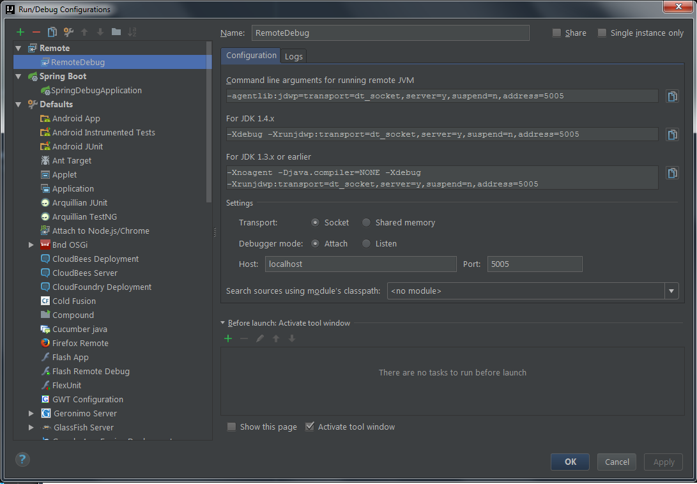
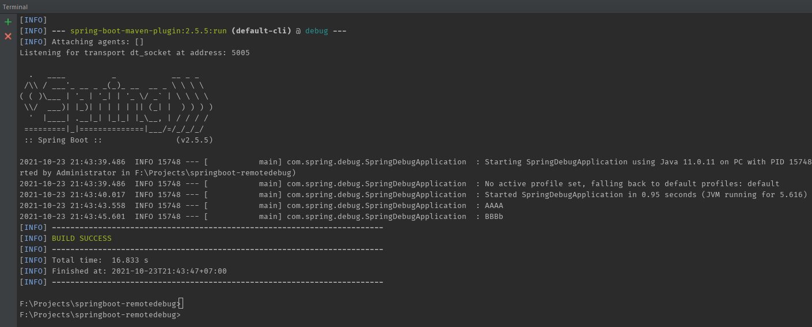
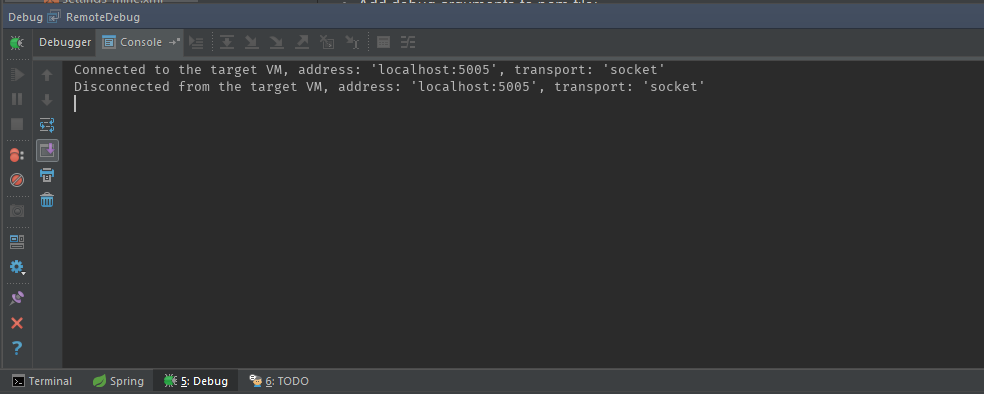

# Spring Boot Remote Debug Demonstration on Intellij IDE
* Select menu Run -> Edit Configurations...
* Create new Remote Configuration. By default you don't need to change settings:
-agentlib:jdwp=transport=dt_socket,server=y,suspend=n,address=5005. But if you want for example to suspend JVM before you connects, you can change suspend=y. Or you can chage port etc.
* Add debug arguments to pom file:
```xml
    <plugins>
        <plugin>
            <groupId>org.springframework.boot</groupId>
            <artifactId>spring-boot-maven-plugin</artifactId>
            <configuration>
                <jvmArguments>
                    -Xdebug -Xrunjdwp:transport=dt_socket,server=y,suspend=y,address=5005
                </jvmArguments>
            </configuration>
        </plugin>
    </plugins>
```
* In Terminal window run your app with (in Maven usage case and JVM 1.5 and higher) mvnw -s settings_mine.xml spring-boot:run 
* Connect to your app by running your Remote Configuration created prviously on step 2. Now you can debug your app. 
